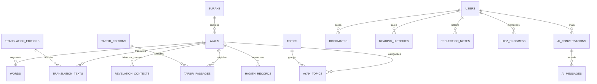

# Noor-ul-Quran (نور القرآن)
## Database Schema, Entity Relationships & Indexing Blueprint

---

## 1. Relational Architecture & ER Diagram

---

## 2. Table Specifications & Data DDL

### Core Quranic Text Tables

#### `surahs`
- `id` INTEGER PRIMARY KEY (1 - 114)
- `name_arabic` VARCHAR(100) NOT NULL
- `name_simple` VARCHAR(100) NOT NULL (e.g., "Al-Fatihah")
- `name_complex` VARCHAR(100) NOT NULL (e.g., "Al-Fātiḥah")
- `name_english` VARCHAR(150) NOT NULL (e.g., "The Opener")
- `revelation_place` VARCHAR(20) NOT NULL CHECK (revelation_place IN ('makkah', 'madinah'))
- `revelation_order` INTEGER NOT NULL
- `bismillah_pre` BOOLEAN NOT NULL DEFAULT TRUE
- `verses_count` INTEGER NOT NULL
- `start_page` INTEGER NOT NULL
- `end_page` INTEGER NOT NULL

#### `ayahs`
- `id` INTEGER PRIMARY KEY (1 - 6236)
- `surah_id` INTEGER NOT NULL REFERENCES surahs(id)
- `verse_number` INTEGER NOT NULL
- `verse_key` VARCHAR(20) NOT NULL UNIQUE (e.g., "1:1", "2:255")
- `text_uthmani` TEXT NOT NULL (Authentic canonical Uthmani script with full diacritics)
- `text_simple` TEXT NOT NULL (Diacritic-stripped Arabic for indexed fast search)
- `juz_number` INTEGER NOT NULL (1 - 30)
- `hizb_number` INTEGER NOT NULL (1 - 60)
- `rub_number` INTEGER NOT NULL (1 - 240)
- `page_number` INTEGER NOT NULL (1 - 604)
- `ruku_number` INTEGER NOT NULL
- `manzil_number` INTEGER NOT NULL
- `sajdah` BOOLEAN NOT NULL DEFAULT FALSE
- `sajdah_number` INTEGER DEFAULT NULL

#### `words`
- `id` INTEGER PRIMARY KEY AUTOINCREMENT
- `ayah_id` INTEGER NOT NULL REFERENCES ayahs(id)
- `position` INTEGER NOT NULL (1-indexed within ayah)
- `text_uthmani` VARCHAR(100) NOT NULL
- `transliteration` VARCHAR(100) NOT NULL
- `translation_en` VARCHAR(150) NOT NULL
- `translation_ur` VARCHAR(150) NOT NULL
- `root_letters` VARCHAR(20) (e.g., "ر ح م")
- `lemma` VARCHAR(100)
- `pos` VARCHAR(50) (Noun, Verb, Particle, Preposition, etc.)
- `grammar_desc` TEXT

---

### Translation & Tafsir Tables

#### `translation_editions`
- `id` INTEGER PRIMARY KEY AUTOINCREMENT
- `identifier` VARCHAR(50) NOT NULL UNIQUE (e.g., "en.saheeh", "ur.maududi", "hi.farooq", "hinglish.paraphrase")
- `language_code` VARCHAR(10) NOT NULL
- `language_name` VARCHAR(50) NOT NULL
- `name` VARCHAR(150) NOT NULL
- `author_name` VARCHAR(150) NOT NULL
- `license` VARCHAR(100) NOT NULL
- `is_canonical_translation` BOOLEAN NOT NULL DEFAULT TRUE

#### `translation_texts`
- `id` INTEGER PRIMARY KEY AUTOINCREMENT
- `ayah_id` INTEGER NOT NULL REFERENCES ayahs(id)
- `edition_id` INTEGER NOT NULL REFERENCES translation_editions(id)
- `text` TEXT NOT NULL
- UNIQUE(ayah_id, edition_id)

#### `tafsir_editions`
- `id` INTEGER PRIMARY KEY AUTOINCREMENT
- `identifier` VARCHAR(50) NOT NULL UNIQUE (e.g., "ibn_kathir", "al_jalalayn", "tafheem_ul_quran")
- `name` VARCHAR(150) NOT NULL
- `author_name` VARCHAR(150) NOT NULL
- `era` VARCHAR(50)
- `methodology` VARCHAR(100) (e.g., "Tafsir bi-l-Ma'thur", "Linguistic & Thematic")
- `publication_info` TEXT
- `license` VARCHAR(100) NOT NULL

#### `tafsir_passages`
- `id` INTEGER PRIMARY KEY AUTOINCREMENT
- `ayah_id` INTEGER NOT NULL REFERENCES ayahs(id)
- `edition_id` INTEGER NOT NULL REFERENCES tafsir_editions(id)
- `text` TEXT NOT NULL
- `volume` VARCHAR(20)
- `page` VARCHAR(20)
- `section_title` VARCHAR(255)

---

### Research, Knowledge Graph & Context

#### `topics`
- `id` INTEGER PRIMARY KEY AUTOINCREMENT
- `slug` VARCHAR(100) NOT NULL UNIQUE
- `title_en` VARCHAR(150) NOT NULL
- `title_ar` VARCHAR(150) NOT NULL
- `title_ur` VARCHAR(150) NOT NULL
- `description` TEXT
- `category` VARCHAR(100)

#### `ayah_topics`
- `id` INTEGER PRIMARY KEY AUTOINCREMENT
- `ayah_id` INTEGER NOT NULL REFERENCES ayahs(id)
- `topic_id` INTEGER NOT NULL REFERENCES topics(id)
- `relevance_weight` FLOAT DEFAULT 1.0
- UNIQUE(ayah_id, topic_id)

#### `revelation_contexts` (Asbab al-Nuzul)
- `id` INTEGER PRIMARY KEY AUTOINCREMENT
- `ayah_id` INTEGER NOT NULL REFERENCES ayahs(id)
- `source_work` VARCHAR(150) NOT NULL (e.g., "Asbab an-Nuzul by Al-Wahidi")
- `report_text` TEXT NOT NULL
- `narrator_chain` TEXT
- `authenticity_assessment` VARCHAR(50) (e.g., "Sahih", "Hasan", "Da'if / Disputed")
- `scholarly_notes` TEXT

#### `hadith_records`
- `id` INTEGER PRIMARY KEY AUTOINCREMENT
- `collection_name` VARCHAR(100) NOT NULL (e.g., "Sahih al-Bukhari")
- `book_number` INTEGER
- `hadith_number` VARCHAR(50) NOT NULL
- `text_ar` TEXT NOT NULL
- `text_en` TEXT NOT NULL
- `text_ur` TEXT
- `narrator` VARCHAR(150)
- `grade` VARCHAR(50) (e.g., "Sahih")
- `grading_authority` VARCHAR(150) (e.g., "Imam al-Bukhari", "Shaykh al-Albani")
- `related_ayah_id` INTEGER REFERENCES ayahs(id)

---

### User Study, Journal & Hifz Tables

#### `reflection_notes`
- `id` INTEGER PRIMARY KEY AUTOINCREMENT
- `user_id` INTEGER NOT NULL
- `ayah_id` INTEGER NOT NULL REFERENCES ayahs(id)
- `title` VARCHAR(255) NOT NULL
- `content` TEXT NOT NULL
- `tags` VARCHAR(255)
- `is_private` BOOLEAN DEFAULT TRUE
- `created_at` TIMESTAMP DEFAULT CURRENT_TIMESTAMP
- `updated_at` TIMESTAMP DEFAULT CURRENT_TIMESTAMP

#### `hifz_progress`
- `id` INTEGER PRIMARY KEY AUTOINCREMENT
- `user_id` INTEGER NOT NULL
- `surah_id` INTEGER NOT NULL REFERENCES surahs(id)
- `start_ayah` INTEGER NOT NULL
- `end_ayah` INTEGER NOT NULL
- `status` VARCHAR(50) NOT NULL (e.g., "learning", "memorised", "review_due")
- `repetitions_count` INTEGER DEFAULT 0
- `ease_factor` FLOAT DEFAULT 2.5
- `interval_days` INTEGER DEFAULT 1
- `last_reviewed_at` TIMESTAMP
- `next_review_at` TIMESTAMP

---

### AI Conversations & Citations

#### `ai_conversations`
- `id` VARCHAR(50) PRIMARY KEY
- `user_id` INTEGER
- `title` VARCHAR(255) NOT NULL
- `language` VARCHAR(20) NOT NULL
- `created_at` TIMESTAMP DEFAULT CURRENT_TIMESTAMP

#### `ai_messages`
- `id` VARCHAR(50) PRIMARY KEY
- `conversation_id` VARCHAR(50) NOT NULL REFERENCES ai_conversations(id)
- `sender` VARCHAR(20) NOT NULL CHECK (sender IN ('user', 'assistant'))
- `content` TEXT NOT NULL
- `citations_json` JSON NOT NULL DEFAULT '[]'
- `verification_status` VARCHAR(50) NOT NULL DEFAULT 'verified_grounded'
- `created_at` TIMESTAMP DEFAULT CURRENT_TIMESTAMP

---

### Auditing & Integrity Tables

#### `audit_logs`
- `id` INTEGER PRIMARY KEY AUTOINCREMENT
- `action` VARCHAR(50) NOT NULL (e.g., "VERIFY_DATASET", "SUBMIT_CORRECTION")
- `entity_type` VARCHAR(50) NOT NULL
- `entity_id` VARCHAR(50) NOT NULL
- `details_json` JSON
- `timestamp` TIMESTAMP DEFAULT CURRENT_TIMESTAMP
